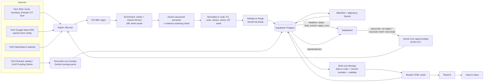

# COMPONENTS MAP

## Architecture

## Components
| Component | Path | Responsibility | In → Out | External |
|---|---|---|---|---|
| Feed fetchers | `src/lib/ingest/feeds.ts` | Fetch/parse RSS, build Google News queries from config, resolve GNews links, NewsData | URLs → `Candidate[]` | RSS feeds, Google News, NewsData |
| Pre-filter | `src/lib/prefilter.ts` | Funding-signal regex + noise exclusion | title/summary → pass/fail | – |
| Enrichment | `src/lib/ingest/enrich.ts` | robots.txt-aware article fetch, cheerio body (incl. roundup tables) | URL → text | publisher sites |
| Extraction | `src/lib/ingest/extract.ts` | Gemini structured output in batches, evidence verification | articles → `ExtractedDeal[]` | Gemini |
| Normalisation | `src/lib/normalize.ts`, `src/lib/fx.ts`, `src/lib/ingest/sector.ts` | Unit/currency conversion, name norm, IST weeks, sector mapping | deals → `NormDeal` | Frankfurter, Gemini (sector fallback) |
| Dedupe & merge | `src/lib/dedupe.ts`, `src/lib/ingest/persist.ts` | name/amount/date matching, Gemini tie-break, field merge, confidence | `NormDeal` → `deals`, `deal_sources` | Gemini, Supabase |
| Ranking | `src/lib/rank.ts` | Config-weighted scoring | deal+config → score | – |
| Adjacency | `src/lib/ingest/persist.ts` (`checkWatchlist`) | exact + Gemini competitor/adjacent/supplier/customer | deals+watchlist → `adjacency` | Gemini |
| Pipeline | `src/lib/ingest/pipeline.ts`, `runlog.ts` | Orchestration, deadline/resume, run + feed logging | – | Supabase |
| Patterns | `src/lib/patterns.ts` | SQL/code stats, Gemini narration, numeric grounding | week → stats + insights | Gemini |
| Reconciliation | `src/lib/reconcile.ts` | Parse weekly roundups, match/miss/mismatch, coverage % | roundup → `reconciliations`, `weeks` | Entrackr, Inc42, Gemini |
| Brief | `src/lib/brief.ts` | HTML email render, store, send | week → `weeks.brief_html` | Resend, Gemini |
| Jobs/Cron | `src/lib/jobs.ts`, `src/app/api/cron/*` | bearer-protected scheduled entrypoints | – | Vercel Cron |
| Admin API | `src/app/api/{admin/run,auth,config}` | passcode cookie, manual triggers, config save | – | – |
| Dashboard API | `src/app/api/{dashboard,system}` | joined deal data, stats, health | – | Supabase |
| Dashboard UI | `src/components/Dashboard.tsx` + `LiveFeed, Ticker, DealTable, DealDetail, PatternsPane, WatchlistPane, CommandBar, AdminControls` | terminal UI, Realtime feed, command bar | – | Supabase Realtime |
| Capital map | `src/components/CapitalMap.tsx` | GRAPH / CITY three.js scene, filtering, fallbacks | deals → picks | three, R3F, drei |
| Command parser | `src/lib/commands.ts` | typed commands & autocomplete | string → action | – |
| Config UI | `src/components/ConfigEditor.tsx` | sectors, stages, cheque, weights, watchlist, sources | – | – |
| Pages | `src/app/{page,config,system,briefs}` | routes | – | – |
| Scripts | `scripts/pipeline-dry.ts`, `scripts/backfill.ts` | dry funnel, 4-week backfill | – | live feeds, Gemini |
| Schema | `supabase/migrations/*.sql` | tables, indexes, RLS, Realtime, seed | – | Supabase |

## External data sources
| Source | URL | Access | Status (verified 2026-10-12) |
|---|---|---|---|
| Inc42 | https://inc42.com/feed/ | RSS | 200, valid XML |
| Inc42 Buzz | https://inc42.com/buzz/feed/ | RSS | 200 |
| YourStory | https://yourstory.com/feed | RSS | 200 |
| Entrackr | https://entrackr.com/rss | RSS (`/feed` is 404) | 200 |
| ET Tech startups | https://economictimes.indiatimes.com/tech/startups/rssfeeds/78570561.cms | RSS | 200 |
| VCCircle | https://www.vccircle.com/rss | – | 404, unused |
| Google News | `https://news.google.com/rss/search?q=…+when:7d&hl=en-IN&gl=IN&ceid=IN:en` | RSS | 200 |
| Entrackr weekly report | https://entrackr.com/report/weekly-funding-report | RSS entry + article fetch | 200 |
| Inc42 Funding Galore | https://inc42.com/tag/funding-galore/feed/ | RSS + article fetch | 200 |
| Frankfurter FX | https://api.frankfurter.app/latest?from=USD&to=INR | API | 200 (₹96.73) |
| NewsData.io | https://newsdata.io/api/1/latest | API (optional key) | not enabled by default |

## Where Gemini is used
| Task | File | Prompt behaviour |
|---|---|---|
| Extraction | `ingest/extract.ts` | Never guess; no currency conversion; verbatim evidence; distinguish rumoured; one result per article; temperature 0; JSON schema |
| Sector mapping | `ingest/sector.ts` | Keyword map first; one batched call maps leftovers to Aarav's taxonomy (enum-constrained) |
| Dedupe tie-break | `ingest/persist.ts` | Yes/no "same round of same company" with reasoning, only for ambiguous matches |
| Adjacency | `ingest/persist.ts` | Compares description+sector to watchlist; competitor/adjacent/supplier/customer + reason; strict |
| Pattern narration | `patterns.ts` | Only supplied facts; 3–6 insights; code rejects any insight with a number not in the facts |
| Roundup parsing | `reconcile.ts` | Same extraction prompt over the full roundup (40k chars), then matched in code |
